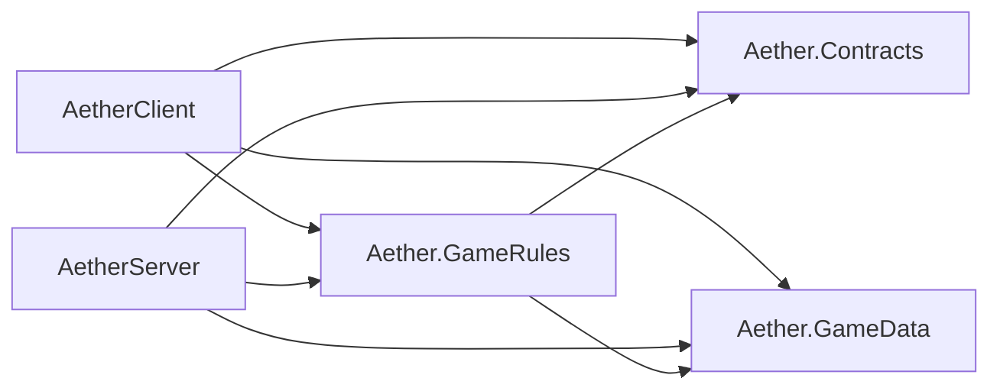

# Technical architecture

AETHER Online is a modular monolith. One authoritative game-server process will own simulation later. Today that process only boots. The client, the server, and the shared libraries are separate projects so server-only code cannot slip into the player build.

## Processes



| Project | SDK | Role |
| --- | --- | --- |
| `client/AetherClient` | Godot.NET.Sdk 4.5.2 | Windows player client. Main scene opens a boot shell. |
| `server/AetherServer` | Godot.NET.Sdk 4.5.2 | Dedicated server. `project.godot` sets `headless=true` under `[aether]`. Run it with `--headless`. |
| `shared/Aether.GameData` | Microsoft.NET.Sdk `net8.0` | Content models and placeholder descriptors. No Godot types. |
| `shared/Aether.Contracts` | Microsoft.NET.Sdk `net8.0` | Session message records. No transport. |
| `shared/Aether.GameRules` | Microsoft.NET.Sdk `net8.0` | Rule interfaces and an empty catalog. References Contracts and GameData. |

The client project does not reference the server project. Contracts and GameData do not reference GameRules, the client, or the server. Nothing in `shared/` references Godot.

Tests live in `tests/Aether.Architecture.Tests` and reference only the shared libraries. They assert this graph, the version pins, the headless marker, and the absence of credentials in samples.

## Why the server is a Godot project

Scene resources, the future isometric presentation, and the planned ENet multiplayer peer are Godot APIs. Keeping the dedicated server in Godot lets those APIs stay next to the content they operate on. Game rules stay in plain C# so they can be tested without launching the engine. The server is still one process: a modular monolith, not a set of microservices.

## Boot behavior

Both projects use a `Main` scene.

The client configures an orthographic camera, adds a placeholder box mesh, and prints one information line. It does not read database settings.

The server prints one information line and reports whether `AETHER_DB_CONNECTION_STRING` is `set` or `unset`. It does not print the value. It does not listen on a socket. With no extra arguments the process keeps running until it is stopped. `--quit-after <frames>` is the smoke check used to prove the scene loads.

## Logging

Both processes write a single console line through Godot's `GD.Print` in this slice. The format is:

```text
[{level}] {message} key=value
```

`AETHER_LOG_LEVEL` selects the level name embedded in that line. When the variable is unset, the level is `Information`. Allowed names, for later filtering, are `Trace`, `Debug`, `Information`, `Warning`, `Error`, and `Critical`. This slice does not filter; it records the configured name.

Do not log connection strings, account credentials, or session secrets. A shared diagnostics type is intentionally not in this slice. Copying the small level read in both boot scripts is temporary.

Sample files in `config/` document the same shape. They are not loaded automatically.

## Configuration

| Variable | Who reads it | Purpose |
| --- | --- | --- |
| `AETHER_LOG_LEVEL` | Client and server | Level name in the boot line. |
| `AETHER_DB_CONNECTION_STRING` | Server only, later | PostgreSQL connection string. Unset now. The sample config stores the variable name, not a value. |

`.env.example` shows the variable names and a commented connection-string shape that uses placeholders. Real values stay outside git. `config/client.example.json` has no database section, so server-only settings are not part of the client sample.

There is no third-party configuration package and no third-party logging package.

## Data

`data/maps/placeholder-haven.json` and `data/appearances/placeholder-traveler.json` match `Aether.GameData.PlaceholderContent`. Nothing loads those files at runtime yet. They contain identifiers and display names only.

## Rules

`IGameRuleModule` has no implementations. `EmptyRuleCatalog.Instance.Modules` is empty. `IContentLookup` and `IMessageKindFilter` are seams for a later catalog and a later session filter. They have no implementations, so they cannot accept a map load or a message.

## Rendering pin

Both Godot projects use the Compatibility renderer (`gl_compatibility`). That keeps headless and low-dependency machines able to open the projects. The art direction is still stylized 3D. A later presentation slice can evaluate Forward+ on machines where Vulkan is the intended desktop path.

## Build outputs

`dotnet build` writes `bin/` and `obj/`. Godot writes `.godot/`. Those directories are gitignored. Do not commit them.

## Out of scope

Combat, movement simulation, inventories, quests, accounts, character progression, PostgreSQL, and any `MultiplayerPeer` are out of scope. See `docs/DEVELOPMENT_ROADMAP.md`.
